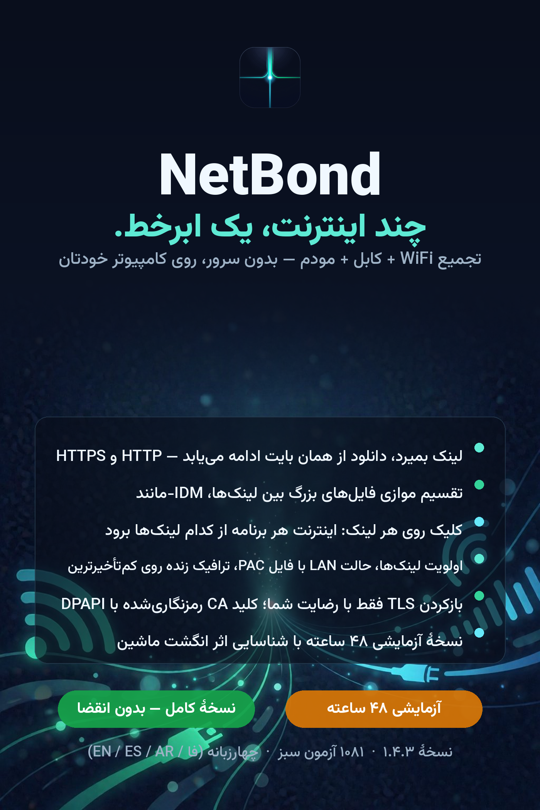

<p align="center">
  
</p>

<h1 align="center">NetBond — پیوند چند اتصال اینترنت روی یک ویندوز</h1>

<p align="center">
  <b>وای‌فای + اترنت + مودم USB + هات‌اسپات موبایل → یک لولهٔ تجمیعی، بدون VPS، بدون ابر، بدون هزینهٔ ماهانه.</b>
</p>

<p align="center">
  
</p>

## NetBond چه می‌کند؟

- **تجمیع چند لینک روی یک ماشین:** ترافیک شما روی همهٔ اتصال‌های فعال پخش
  می‌شود تا throughput نهایی **جمعِ** لینک‌ها باشد، نه سریع‌ترین آن‌ها.
- **دو موتور:** پراکسی محلی HTTP/SOCKS5 (بالانس پر-اتصال، سازگار با هر برنامهٔ
  پراکسی‌پذیر از جمله مدیریت‌کننده‌های دانلود) و حالت شفاف TAP/TUN برای کل
  سیستم.
- **مسیردهی برنامه‌ای:** در جدول لینک‌ها تیک بزنید، سپس خروجی تجمیعی را به یک
  یا چند برنامهٔ خاص route کنید.
- **تقسیم دانلود:** دانلودهای بزرگ byte-range روی چند لینک تقسیم می‌شوند.
- **سیاست fail-open:** اگر لینکی وسط کار بمیرد، ترافیک روی بازمانده‌ها ادامه
  می‌یابد؛ نشست هرگز قطع نمی‌شود.
- **راهنمای داخل برنامه** به فارسی، انگلیسی، اسپانیایی و عربی (GUI و CLI).

## مدل لایسنس (آفلاین و حریم‌خصوصی‌محور)

- **نسخهٔ آزمایشی ۴۸ ساعته** با همهٔ قابلیت‌ها، بدون ثبت‌نام.
- نسخهٔ کامل با **کلید دائمی قفل‌شده به سخت‌افزار** همان ماشین (UUID بایوس،
  شناسهٔ CPU، سریال دیسک سیستم، MAC و…): کلید لو رفته روی ماشین دیگر اصلاً
  اجرا نمی‌شود و کلید لو رفته در انتشار بعد قابل ابطال است.
- **هرگز هیچ اتصال خروجی برای بررسی لایسنس وجود ندارد**؛ فعال‌سازی ۱۰۰٪ آفلاین.

## دریافت NetBond

| نسخه | از کجا |
|---|---|
| **آزمایشی (۴۸ ساعته، کامل)** | بخش [Releases](../../releases) → `netbond-1.6.5-trial48.zip` |
| **کامل (لایسنس دائمی)** | خرید با **تتر TRC20** یا **ریال** — پیوند صفحهٔ فروش در بخش About مخزن |

SHA-256 برای راستی‌آزمایی دانلود:
`daaa73c9d246cfa368658c873e84d70f8e274dde8e355a761ba8905b5e77d919`

## شروع سریع (ویندوز)

۱. zip آزمایشی را از **Releases** دانلود و Extract All کنید.
۲. روی `run_netbond.pyw` دبل‌کلیک کنید (یا یک‌بار `build_exe.bat` بزنید تا
   `netbond-gui.exe` مستقل ساخته شود).
۳. آداپتورهای مورد نظر را تیک بزنید، سیاست را انتخاب کنید و شروع کنید.
۴. یا پراکسی محلی را به برنامه‌ها بدهید، یا `netbond win-proxy on` بزنید، یا
   حالت شفاف برای کل سیستم.

```text
netbond links          # چه چیزی شناسایی شد
netbond run            # موتور + داشبورد
netbond win-proxy on   # کل سیستم از NetBond
netbond fingerprint    # کد تک‌خطی سخت‌افزاری برای لایسنس
netbond activate --key-file KEY.key
```

## مستندات

- `docs/help_fa.md` — راهنمای کامل داخل برنامه (فارسی)
- `docs/help_en.md` — English manual
- `docs/help_es.md` / `docs/help_ar.md` — اسپانیایی / عربی

## چرا Speedify یا VPS نه؟

Speedify هزینهٔ ماهانه دارد و ترافیک شما از ابر آن‌ها می‌گذرد؛ راه‌حل‌های
OpenMPTCProuterی به VPS با IP عمومی نیاز دارند. NetBond **محلی، روی یک
ماشین، بدون هیچ سرور ثالثی در مسیر** می‌چسباند.

## پروانه

مواد منتشرشده در این مخزن (مستندات، پوسترها، یادداشت‌های انتشار) تحت MIT؛
خودِ محصول نرم‌افزار تجاری است با لایسنس دائمی per-machine و نسخهٔ آزمایشی
رایگان برای ارزیابی.
