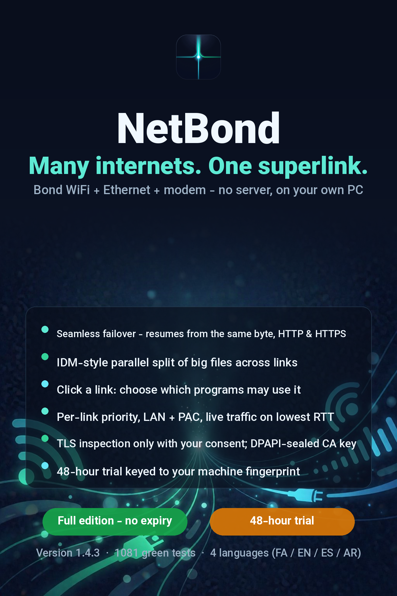

<p align="center">
  
</p>

<h1 align="center">NetBond</h1>

<p align="center">
  <b>Bond every internet connection on one Windows PC — no VPS, no cloud, no monthly fee.</b><br>
  Wi‑Fi + Ethernet + USB modem + phone hotspot → one aggregated pipe.
</p>

<p align="center">
  
  
  
  
</p>

<p align="center">
  
</p>

## What NetBond does

- **Multi-uplink bonding** on a single machine: spreads your traffic over every
  connected link (Wi‑Fi, Ethernet, 4G dongle, phone hotspot) so the aggregate
  throughput becomes the *sum* of the links, not the fastest one.
- **Two engines:** a local HTTP/SOCKS5 proxy (per-connection balancing, works
  with any proxy-aware app, including download managers) and a transparent
  system-wide TAP/TUN mode for everything else.
- **Per-app routing:** tick the adapters you want in the Links table, then route
  the aggregate into one or more specific programs.
- **Download splitting:** big downloads can be split across links byte-range
  style for a real speed-up.
- **Fail-open policy:** if a link dies mid-flight, traffic keeps flowing over
  the survivors — the session never drops.
- **In-app manuals** in Persian, English, Spanish and Arabic (GUI and CLI).

## Licence model (offline & privacy-first)

- Full-featured **48-hour trial**, no signup.
- The full version uses a **perpetual licence key locked to your hardware**
  (firmware UUID, CPU id, system-disk serial, MAC…): a leaked key simply does
  not run on another machine, and leaked keys can be revoked in the next
  release.
- **No phone-home, ever.** Activation and verification are 100% offline.

## Get NetBond

| Edition | Where |
|---|---|
| **Trial (48 h, all features)** | [Releases](../../releases) → `netbond-1.6.5-trial48.zip` |
| **Full (perpetual licence)** | Buy with **USDT (TRC20)** or **Iranian Rial** — sales page linked from the repo *About* section |

SHA-256 of the trial zip (verify after download):
`daaa73c9d246cfa368658c873e84d70f8e274dde8e355a761ba8905b5e77d919`

## Quick start (Windows)

1. Download the trial zip from **Releases** and Extract All.
2. Double-click `run_netbond.pyw` (or run `build_exe.bat` once to produce a
   standalone `netbond-gui.exe`).
3. Tick the adapters you want to bond, choose a policy, press start.
4. Point your apps at the local proxy, or run `netbond win-proxy on` to set the
   system proxy, or use transparent mode for everything.

```text
netbond links          # what was discovered
netbond run            # start the engine + dashboard
netbond win-proxy on   # route the whole system through NetBond
netbond fingerprint    # your one-line hardware code (for licensing)
netbond activate --key-file KEY.key
```

## Documentation

- `docs/help_en.md` — the full in-app manual (English)
- `docs/help_fa.md` — راهنمای کامل فارسی
- `docs/help_es.md`, `docs/help_ar.md` — Spanish / Arabic

## Why not Speedify / a VPS?

Speedify needs a monthly subscription and routes your traffic through their
cloud. OpenMPTCProuter-style setups need a VPS with a public IP. NetBond bonds
**locally, on one machine, with no third server in the path** — your traffic
never leaves your links except toward its real destination.

## Licence

MIT for the materials published in this repository (docs, assets, release
notes). The full product binaries are commercial software sold with a
per-machine perpetual licence; the trial build is free to evaluate.
